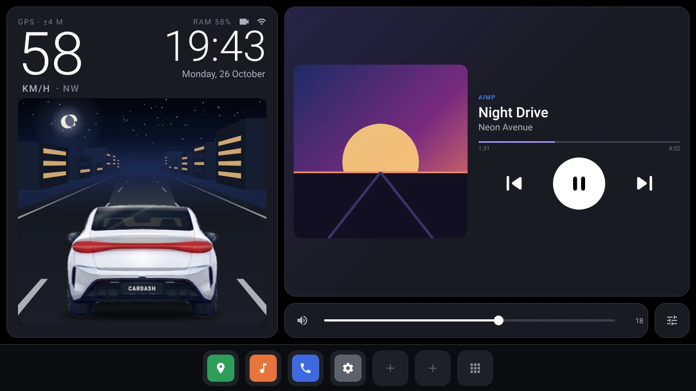
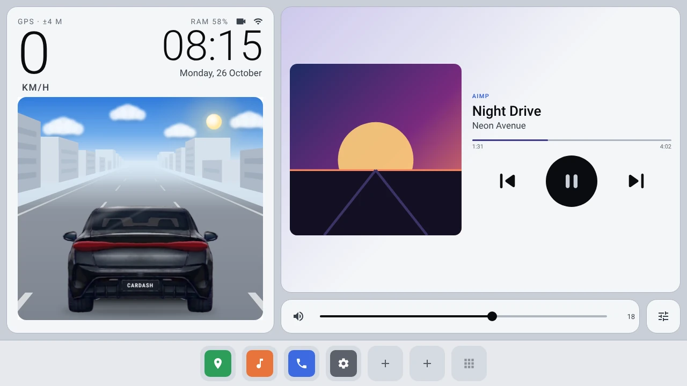
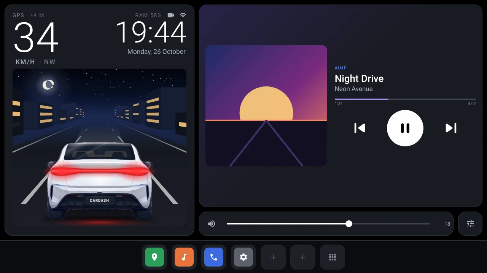
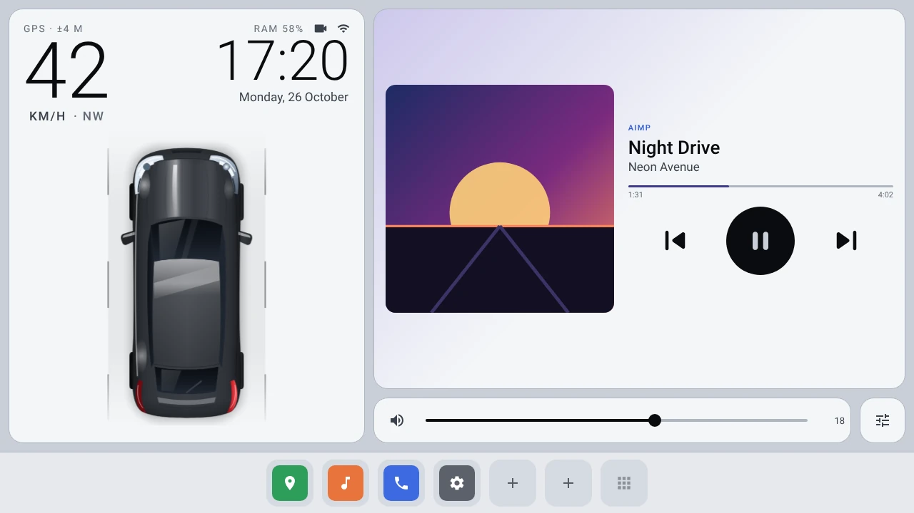
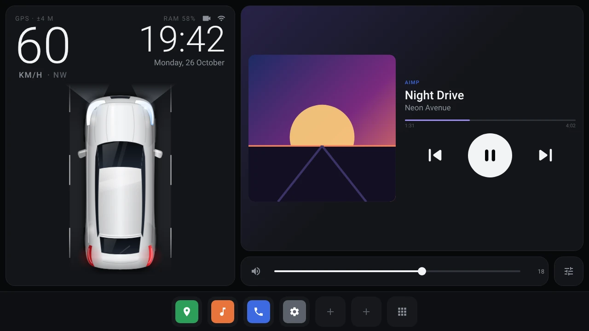
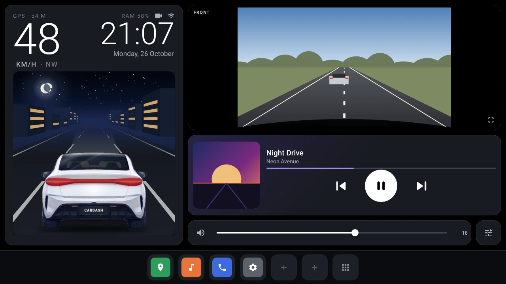
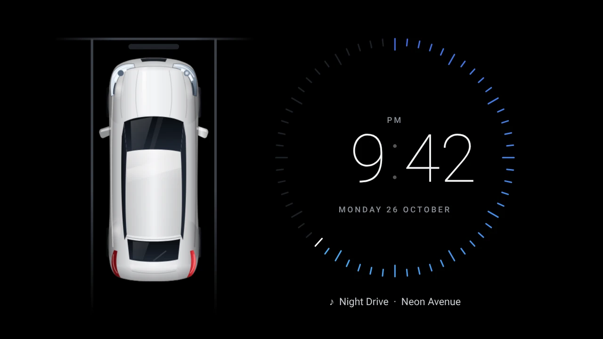
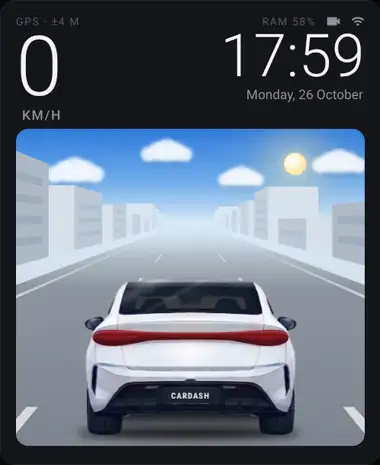
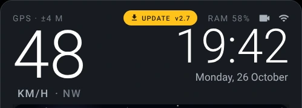

<div align="center">

# CarDash

**A lightweight home screen for Android car head units.**

Built for the cheap 2 GB units that struggle with heavy stock launchers: framework-only Java,
no third-party libraries, an APK under 0.5 MB, and zero frames drawn when nothing changes.

[](https://github.com/ox1d3x3/cardash/releases/latest)
[](https://github.com/ox1d3x3/cardash/actions/workflows/ci.yml)
[](https://github.com/ox1d3x3/cardash/releases)


[**Download the latest APK**](https://github.com/ox1d3x3/cardash/releases/latest) ·
[Features](#features) · [Install](#installation) · [Updates](#automatic-updates) ·
[Build](#building-from-source) · [Release](#releasing)



</div>

---

## Contents

- [Screenshots](#screenshots)
- [Features](#features)
- [Requirements](#requirements)
- [Installation](#installation)
- [Automatic updates](#automatic-updates)
- [Feature guide](#feature-guide)
- [Dash cam (DDPAI) live view](#dash-cam-ddpai-live-view)
- [RAM optimiser](#ram-optimiser)
- [Performance by design](#performance-by-design)
- [Building from source](#building-from-source)
- [Releasing](#releasing)
- [Project structure](#project-structure)
- [Diagnostic logs](#diagnostic-logs)
- [Troubleshooting](#troubleshooting)
- [Limitations](#limitations)
- [Acknowledgements and disclaimer](#acknowledgements-and-disclaimer)

## Screenshots

| Day | Night |
| :---: | :---: |
|  |  |
| **Chase cam**: sun, clouds and your own number plate | **Sudden stop**: brake lights pop, the road glows red |
|  |  |
| **Top-down view**: lamps off by day | **Top-down at night**: LED headlamps and beams |
|  |  |
| **Dash cam layout**: live DDPAI tile | **Screensaver**: car parks, ring clock |

<p align="center">
  <br>
  <sub>At 6 pm the sun sets, the moon rises and the city lights come on.</sub>
</p>

<sub>Screenshots are rendered previews of the 1280×720 layout.</sub>

## Features

- **Live car on the road**: a glossy car that drives with your GPS speed, in a **top-down** or
  **chase-cam** view, in hatchback or sedan form and any paint colour.
- **Lights that behave like a car's**: headlamps and tail lamps from 6 pm to 5 am (or real
  sunset to sunrise); **brake lights pop only on a sudden speed drop**, never on gentle slowing.
- **Living sky**: sun, clouds and blue sky by day; moon, twinkling stars, shooting stars and lit
  windows at night, with a dusk transition.
- **Your number plate** on the back of the car, and **your own badge**: chrome lettering you type,
  or an image you load (CarDash cuts out a plain background and can give it a chrome finish).
- **Big speed and clock**, a speed alert, km/h or mph.
- **A greeting with your name**: *Welcome* after start-up, then *Good morning / afternoon /
  evening*. It gives way to the speed the moment you drive off.
- **Now playing** for any player (AIMP, Spotify, YouTube Music, radio apps…), with any of them as
  your default: album art, big buttons, **swipe to skip**, volume in sync with the hardware knob.
  Or put **Spotify's / YouTube Music's own widget** in the music card instead.
- **Dash cam**: live DDPAI front camera over Wi-Fi and the wired rear camera, full screen or as a
  home-screen tile, with Android Auto / CarPlay protection.
- **RAM optimiser** that is careful by design: phone-link and playing apps are never touched.
- **Screensaver**: the car parks and locks, beside a ring clock, and a **sleepy cat** wanders in,
  hops onto the roof and curls up. Tap and it bolts, then the dashboard comes back.
- **Auto day / night theme** that switches instantly, with no restart and no flash.
- **Updates itself from GitHub**: a yellow update icon appears when there's a new release; one tap
  downloads and installs it.
- **About** (*Settings → About CarDash*): version, developer, source code, update check.

## Requirements

| | |
| --- | --- |
| Android | 8.0 (API 26) or newer. Developed on Android 13. |
| Screen | Landscape. Tuned for 1280×720, also fits 1024×600. |
| Memory | Runs comfortably on 2 GB RAM units. |
| Sensors | GPS for speed. No CAN-bus access needed. |
| Optional | Root (for Deep-mode RAM cleaning and silent updates); a DDPAI dash cam. |

## Installation

1. **Download** `CarDash-vX.Y.apk` from the [latest release](https://github.com/ox1d3x3/cardash/releases/latest)
   and open it on the head unit (from a USB stick or the unit's browser), or use ADB:
   ```sh
   adb install -r CarDash-v2.4.apk
   ```
2. Press **Home** and choose **CarDash → Always**.
   If the unit never asks: *Settings (slider icon) → Set CarDash as Home app*.
3. Allow **location** when asked (for the speedometer).
4. Tap the media card and enable **notification access** for CarDash. This is how Android lets a
   launcher see the playing track; CarDash never reads your notifications. If the unit hides that
   screen:
   ```sh
   adb shell cmd notification allow_listener xyz.ox1de.cardash/xyz.ox1de.cardash.MediaListener
   ```
5. *Optional, on FYT / TS-style units:* in the factory settings, set CarDash as the default launcher
   and stop the stock launcher from auto-starting after ignition.

> [!NOTE]
> Updating from **v2.3 or older**: install v2.4 once by hand. From v2.4 on, CarDash updates itself.

## Automatic updates

CarDash checks this repository's [Releases](https://github.com/ox1d3x3/cardash/releases) and
updates itself, so there is nothing to copy over by USB after the first install.

<p align="center"></p>

**How it works**

1. **Check** (on by default): about 25 s after the home screen appears, then every 6 hours.
   CarDash looks for the newest release with an `.apk` attached that is newer than the installed
   version.
2. **Yellow update icon**: when there is one, a yellow **UPDATE vX.Y** icon pops up next to the RAM
   figure (with a short pulse and a one-time message, then it sits still). Tap it to see what's new.
3. **Download & install**: one button. The dialog shows the download progress, the APK is verified
   (**same app**, **newer version**, **signed with the same key** as the installed copy, anything
   else is discarded), then it installs. CarDash restarts on the new version and shows
   *Updated to CarDash vX.Y*.

**Settings → Updates** (also in *Settings → About CarDash*)

| Option | What it does |
| --- | --- |
| Check for updates now | Asks GitHub right away and shows what it found. |
| Check automatically | Every 6 hours. **On** by default. |
| When there's an update | **Show the yellow update icon** (default: you tap to download and install) · **Download in the background, then ask** · **Install automatically when parked** |
| Beta versions | Also offer pre-releases (`vX.Y-betaN`). Off by default. |
| All releases on GitHub | Opens the releases page. |

**Permissions, once**

- **Without root**, Android asks you to allow CarDash to *install unknown apps* the first time.
  CarDash takes you to that switch. On Android 12+, after CarDash has installed itself once, later
  updates go through without a confirmation screen.
- **With root** and *RAM optimiser → Deep mode* on, updates install silently through `pm install`.

> [!TIP]
> GitHub allows 60 unauthenticated API requests per hour per IP address. CarDash uses at most
> one request per check, so automatic checks never come close to that limit.

## Feature guide

<details>
<summary><b>Drive panel and car views</b></summary>

- Big **GPS speed** (tap to switch km/h ↔ mph) and **clock** share the top row. Sizes are computed
  from the panel's real size, so they fill a 10" 1280×720 unit and still fit 1024×600 or the
  Dash cam layout. The speed number rolls through the values in between instead of jumping once a
  second.
- **Top-down view**: the glossy vector car (*Hatchback* or *Sedan*) with shaded paint, clear-coat
  reflections, tinted glass and projector headlamps. Generated by `tools/cargen.py` and rendered once.
- **Chase-cam view** (*Settings → Car view → behind the car*): the road runs to the horizon under a
  sky that follows the clock; lane dashes and roadside buildings stream past with your speed. The
  car is the owner's own straight-on EV design, rendered with `tools/rearart/` (symmetric body,
  clean lamps, reflections on their own layer).
- **Paint colour**: *Auto* (white car on the dark theme, black on the light theme) or a fixed
  colour. Changes cross-fade, including the automatic switch at 6 pm / 5 am.
- **Number plate** (*Settings → Number plate*): letters, digits, space, dash and dot, up to 10.
- **Rear badge** (*Settings → Rear badge*), on the boot lid under the light bar, chase cam only:
  - **Chrome lettering**: up to 12 characters you type, e.g. your model name.
  - **Your own badge image**: any PNG or JPG on the head unit (picked with its file manager or
    gallery). A plain background (white, black, any flat colour) is cut away automatically, empty
    margins are trimmed and it's stored at most 256 px. Finish: **chrome** (default) or **original
    colours**. A PNG with a transparent background gives the cleanest result.
  - It's painted into the car picture once, so it costs nothing per frame. CarDash itself ships no
    badges or brand logos; what you load stays on your unit.
- **Greeting** (*Settings → Greeting*): the first time after install or after the head unit boots,
  the speed slot says *Welcome, &lt;your name&gt;*, which turns into *Good morning* (5:00–11:59),
  *Good afternoon* (12:00–16:59) or *Good evening* (17:00–4:59). After the unit has slept, been
  switched off or been away from the home screen for 10+ minutes, the time-of-day greeting comes
  back. It stays while you're parked and fades away as soon as GPS sees the car moving (two fixes
  above about 7 km/h, so standstill jitter can't trigger it), and the speed takes its place. Tap it
  to dismiss it, long-press it to change your name.
- **Speed alert**: choose a limit and the speed turns red above it.

</details>

<details>
<summary><b>Lighting and brake lights</b></summary>

- From 6 pm to 5 am (or real sunset to sunrise in that theme mode), the LED headlamps power on with
  a quick ramp, the beams light the road and the tail lamps glow. In the day all lamps stay off.
- Day or night, the **brake lights pop on only when the speed drops suddenly**: firm braking,
  about 6.5 km/h per second or more, measured over at least 0.4 s so 1 Hz and 10 Hz GPS behave the
  same. They snap on with a flare, stay on while the speed keeps falling, then fade. Gentle slowing
  and coasting never light them, and impossible jumps (GPS glitches) are ignored.
- In the chase cam the high-mounted stop lamp lights too, the road glows red under the bumper and
  the car's tail lifts a touch as the brakes bite.
- On start-up the car fades in and the lamps flash once.

</details>

<details>
<summary><b>Theme, sky and screensaver</b></summary>

- **Auto day / night theme**: light 5 am – 6 pm, dark 6 pm – 5 am. Both are tuned for head-unit LCDs,
  which flatten contrast: the dark theme is true black with clearly lifted cards and bright text; the
  light theme is grey with off-white cards (pure white blooms and washes out) and darker text. An optional *real sunrise /
  sunset* mode computes today's times offline from where GPS last saw the car. Or force always dark
  or always light. Switching swaps colours in place.
- **Sky** (chase cam): blue sky, sun and drifting clouds by day; a crescent moon, twinkling stars,
  the odd shooting star and lit city windows at night. At 6 pm the sun sets with a warm dusk glow
  and the moon rises, and the reverse at 5 am.
- **Screensaver**: after 2 minutes idle while parked (configurable), or right away with the **moon
  key on the dock** (or long-press the clock, or *Settings → Screensaver → Start now*). The car
  rolls into a parking bay, brakes and flashes its indicators as it locks; beside it a ring clock
  with a 60-tick seconds ring, date, **media controls** (previous / play-pause / next), now
  playing, and your speed if you pull away. *Settings → Parked car on screensaver* turns the car
  off. The media controls work without closing the screensaver; a touch anywhere else wakes the
  dashboard without pressing what's underneath.
  **Driving off closes it**: two GPS fixes in a row above about 8 km/h (or the head unit waking up
  on ignition) bring the dashboard back, and the cat bolts first. The automatic screensaver always
  closes; for one you started by hand, *Settings → Screensaver started by hand closes when you drive
  off* chooses yes (default) or no. Also available as Android's system screensaver
  ("CarDash Clock") where the unit has that menu.
- **Sleepy cat** (*Settings → Sleepy cat on the parked car*, on by default): a moment after the car
  locks, a ginger tabby walks in, stops beside the car, wiggles, jumps onto the roof, turns round
  once and curls up to sleep, breathing, with little z's drifting up. Tap the screen and it startles
  (!), leaps off and runs away across the clock, then the dashboard comes back. It's all vector
  shapes: full frame rate only while it's moving (about 6 s in, 1.3 s out), 10 fps while it sleeps,
  and the clock stays at one redraw per second otherwise.

</details>

<details>
<summary><b>Music, volume and dock</b></summary>

- **Now playing**: album art (the card picks up a soft wash of the album colour), title, artist,
  progress and big previous / play-pause / next buttons. **Swipe the card** left for the next
  track and right for the previous one. It controls whichever app is actually playing.
- Tap the card to open the player; long-press it (or *Settings → Music player*) to choose your
  default player. Music apps (Spotify, YouTube Music, AIMP, Poweramp…) are listed first; AIMP is
  picked automatically if nothing is chosen. Pressing play with nothing playing resumes the last
  player, or opens your default player if that's a different app.
- **Music card: CarDash player or an app's widget** (*Settings → Music card*). The built-in player
  is the lightest and works with every app. Alternatively the card can host a music app's own
  home-screen widget (Spotify, YouTube Music, AIMP…; music apps are listed first), the same way a
  phone's home screen does: the app draws it and taps go straight to the app. Android asks once to
  allow CarDash to show widgets. Long-press the widget for *Open app*, *Change widget* or *Back to the
  CarDash player*. Widget updates are only received while the home screen is visible.

  Showing the app's *full* screen inside the card isn't possible: Android only lets system apps embed
  another app's window, and split-screen can't include the home screen.
- **Resume music after start** (opt-in): once per boot, if nothing is playing after about 8 s,
  CarDash presses play for the last music app.
- **Volume**: slider and mute for the media stream, kept in sync with the hardware knob and wheel
  buttons.
- **Dock**: 6 app slots plus an all-apps grid. Tap an empty slot to fill it, long-press any slot to
  change it. Defaults are detected automatically: maps, music player, phone / Bluetooth, settings.
  - **All apps**: the grid key opens every app; the dock **stays on screen** underneath it, and
    **Back** and **Recent apps** appear on its left (the grid key turns into a close key). Back
    takes you back to the dashboard; Recent apps opens Android's recent apps (with *CarDash
    buttons* on), or else CarDash's own list of the apps you opened from it.
  - **Right: Screensaver now (moon) and Shortcuts (⋯).** Shortcuts opens a panel of big tiles:
    Notifications, Quick settings, Recent apps, Screenshot, Screensaver, Volume, Wi-Fi, Bluetooth,
    Screen off, Power menu, Android settings, CarDash settings.
  - On a narrow screen the keys shrink a little so everything fits.
- **CarDash buttons** (one-time switch): Back, Recent apps, Notifications, Quick settings,
  Screenshot, Screen off and the Power menu are Android's own keys, and Android only lets an app
  press them through an accessibility service you turn on: *Settings → Accessibility → CarDash
  buttons*. It requests no window content and no events from other apps; it only presses those keys.
  CarDash offers to do it for you with root (Deep mode), and shows the ADB command for units that
  hide the Accessibility menu:
  `adb shell settings put secure enabled_accessibility_services xyz.ox1de.cardash/xyz.ox1de.cardash.KeysService`.
  If Android 13 greys the switch out ("restricted setting"): *Settings → Apps → CarDash → ⋮ → Allow
  restricted settings*. Notifications and Quick settings also work without it on most units.

</details>

<details>
<summary><b>Layouts, system bars and settings</b></summary>

- **Layout** (*Settings → Layout*): **Standard** (car · music) or **Dash cam** (car · live front
  camera tile · compact player). Tap the tile for full screen; the video moves over without
  reconnecting.
- **System bars**: the status bar is hidden on the home screen by default (most head units leave it
  empty); swipe down from the top edge to peek. *Settings → System bars* can show it again or hide
  the navigation bar too. CarDash draws edge to edge and leaves room only for bars that are really
  showing, so a hidden status bar gives its whole strip back to the dashboard (some head units kept
  reporting that space even with the bar hidden).
- **Settings** (slider icon): updates, greeting, music card, music player, theme, car colour, style, view and number
  plate, rear badge, units, speed alert, screensaver, sleepy cat, RAM optimiser, layout, dash cam, resume music, media
  access, location, system bars, set as Home app, reset dock, About CarDash (version, developer
  Mahabub Subhany / [ox1d3x3](https://github.com/ox1d3x3), source code, update check).

</details>

## Dash cam (DDPAI) live view

DDPAI cameras run a small server on their own Wi-Fi at `193.168.0.1` (documented by the community:
[hackaday.io project 167990](https://hackaday.io/project/167990),
[awexandrr/ddpai-api](https://github.com/awexandrr/ddpai-api)). CarDash:

1. Uses the camera if the head unit is already on its Wi-Fi; otherwise asks Android to join it
   **for CarDash only** (a one-time system prompt). Network name: automatic (anything containing
   "DDPAI"), password `1234567890` by default; both editable in *Settings → Dash cam*. When the
   view closes, Android restores the previous Wi-Fi by itself.
2. Logs in and switches the camera to live mode over its HTTP API (best effort; firmware varies).
3. Plays `rtsp://193.168.0.1:554/liveRTSP/av4` (front) or `av5` (rear) with a built-in RTSP client
   (RTP interleaved over TCP), falling back to the older raw H.264 stream on port 6200. Video is
   decoded by the head unit's hardware decoder straight to the screen; if the decoder falls behind
   it skips to the next keyframe instead of building up delay.
4. Reconnects on drops. Every step is logged: *Settings → Dash cam → Last connection log*.

<details>
<summary><b>Dash cam layout, rear camera and wireless Android Auto / CarPlay</b></summary>

**Dash cam layout**: one camera session serves both the home tile and the full-screen view (the
decoder output is switched live with `MediaCodec.setOutputSurface`). It runs only while the home
screen is visible: leaving home or the screensaver releases the camera Wi-Fi, and coming back
reconnects. If the DDPAI is off, the tile says so and retries every minute.

**Rear camera**: the head unit's AV-in / reversing camera through Camera2 (*Settings → Dash cam →
Rear camera* lists what the unit exposes). If the unit's own reverse screen is holding the camera,
CarDash says so. Units that don't share the camera can use "Open the head unit's camera app
instead".

**Wireless Android Auto / CarPlay** runs over a Wi-Fi network the head unit hosts for the phone.
The DDPAI is a 2.4 GHz network the same chip must join too; chips that can't do both at once
time-share the radio, so Android Auto can stutter. By default CarDash protects it:
- the home tile pauses while a hosted phone link is up, and waits 60 s after boot so your phone
  connects first;
- the full-screen view asks "View anyway?" while a link is up; the override lasts for that viewing.

*Settings → Dash cam* shows whether a link is detected right now. Wired Android Auto and the wired
rear camera are never affected.

Good to know:
- While the camera is on screen, the head unit is on the camera's Wi-Fi, so a phone-hotspot internet
  connection may pause on units that can't do two networks at once.
- The camera serves one app at a time: disconnect the phone's DDPAI app first.
- Tested against real RTSP servers (Digest / Basic auth, 480p–1440p, keep-alive) and a mock DDPAI
  API. If it doesn't play, the log says exactly where it stopped.

</details>

## RAM optimiser

Android already evicts cached apps when it needs memory, and stopping apps you'll reopen only makes
them start cold. So the optimiser is deliberately conservative. Tap the **RAM %** chip to clean
now; long-press it for settings.

- **Gentle by default**: acts only below 20 % free RAM and goes further only below 10 % (or when
  Android reports low memory). *Balanced* (30 % / 15 %) is optional. Anything used in the last 10
  minutes is never stopped.
- **Phone-link apps are never stopped** (CarPlay / Android Auto receivers such as ZLINK, AutoKit,
  TLink, SpeedPlay, EasyConnection, Carbit), found by package name, app label (including Chinese
  labels) and USB-attach handlers. The list is visible in *RAM optimiser → Protected car &
  phone-link apps*.
- **Also never touched**: whatever is playing, your chosen player, dock apps (optional), the
  keyboard, dialer / SMS, accessibility and notification-listener apps, device admins, Google Play
  services, Bluetooth, DVR / cameras, radio, CAN / MCU, TPMS, OBD and TTS.
- **Learns**: apps opened in the last hour stay warm; regulars (3+ opens this week) stay warm unless
  RAM is critical. With optional *Usage access* it also sees apps opened outside CarDash:
  `adb shell appops set xyz.ox1de.cardash GET_USAGE_STATS allow`.
- **Normal mode (no root)** uses `killBackgroundProcesses`, which by design only removes cached
  background processes: it *cannot* interrupt playing music, running navigation or foreground
  services.
- **Deep mode (root)** sees what is actually running, reports what it stopped, and blocks apps that
  keep respawning (three times within an hour, not opened this week) from background running. Every
  block can be undone. One persistent `su` shell, so Magisk asks once.

No root? You can still keep a pre-installed app out of the background over ADB:

```sh
adb shell cmd appops set <package> RUN_ANY_IN_BACKGROUND ignore   # undo: … allow
adb shell pm disable-user --user 0 <package>                       # undo: pm enable <package>
```

## Performance by design

CarDash is built to cost nothing when nothing changes.

- **No frames while idle.** The road animates only while the car moves or a light is fading, and a
  GPS fix that says "still parked" doesn't redraw anything. Parked, or with another app in front:
  no road frames, no CPU.
- **The sky is its own layer.** In the chase cam the sky (gradients, sun, moon, stars, clouds) sits
  under the road on a separate view. The clouds glide by moving that layer only (30 updates a
  second, sub-pixel), so the road, buildings and car are never redrawn for them; stars twinkle at
  12 fps in the sky layer alone, a shooting star runs at full rate only while it flies. All of it
  stops behind the drawer, the camera, the screensaver or another app.
- **Background work stays in the background.** App icons, album art, badge import and car rendering
  run on threads at Android's background priority, so they never take CPU from an animation.
- **Render once, composite every frame.** Car art, lamp bands and sky layers are rasterised once on
  a background thread; a frame is a few bitmap draws and flat convex shapes on the GPU, with no
  allocations. The number plate is painted into the car bitmap once, not per frame.
- **Motion on the GPU.** UI animations change only scale, alpha and translation, so nothing is
  re-measured or re-laid-out mid-animation. Frame timing follows the display's vsync. Views that
  would otherwise be re-rendered offscreen while they fade get a hardware layer for the animation
  only; plain text fades without one.
- **Album art off the main thread.** Players send big art (often 640–1000+ px) and re-send it with
  every metadata update. CarDash fingerprints it, scales it to the size it's shown at and picks its
  colour on a background thread, and applies it only when the picture actually changed: one small
  texture per track, so track changes never stutter.
- **Play / pause morphs** from the triangle into the bars on the render thread.
- **Day / night switch cross-fades.** At 6 pm and 5 am the old screen fades away over the new
  theme (one GPU read-back of the window, freed after 0.6 s) instead of snapping.
- **Stable layouts.** Speed, clock and track text live in fixed-size views and update only when the
  value actually changes.
- **Quiet in the background.** GPS, media callbacks and timers stop in `onPause`. The clock uses the
  system `TIME_TICK` broadcast. App icons are rendered once at their exact size, dock first, and
  package changes refresh only the affected app.
- **Pixel-exact, crisp drawing.** Everything renders at the panel's native resolution and at the
  exact size it's shown: the car pictures, sky, album art and app icons are made at their final
  pixel size and drawn 1:1 at whole-pixel positions, so the GPU never resamples them (a bitmap
  placed between pixels comes out soft). The rear car art is scaled down in clean halving steps and
  gently sharpened for soft head-unit panels. (Dynamic resolution, as in games, would lower the
  resolution under load; CarDash doesn't need it and would only look softer for it.)
- **Small.** No AndroidX, no Kotlin runtime, no web views, no third-party libraries. R8 shrinks the
  release build to under 0.5 MB.

## Building from source

The app is plain Java against the Android framework (`minSdk 26`, `targetSdk 33`, `compileSdk 34`).

**Android Studio / Gradle** (JDK 17, Gradle 8.7+):

```sh
gradle :app:assembleRelease
# → app/build/outputs/apk/release/app-release.apk
```

**GitHub Actions**: every push to any branch is built by the [CI workflow](.github/workflows/ci.yml);
the APK is attached to the run as an artifact for 14 days.

**Without the Android SDK**: build with only `android.jar` and Google's bundletool (which ships
aapt2, D8 and apksig):

```sh
tools/build-local.sh path/to/android.jar path/to/bundletool-all.jar
# → build-local/CarDash.apk
```

**Car art**: the top-down car layers in `app/src/main/res/drawable/car_{hatch,sedan}_*.xml` are
generated by `tools/cargen.py`. The chase-cam car (`res/drawable-nodpi/rear2_*.webp`) is built from
`tools/rearart/design.jpg` by the scripts in `tools/rearart/`.

**Signing**: all builds are signed with `keystore/cardash.p12`, so every build installs as an update
over the last. Android only accepts an update signed with the same key as the installed app.

## Releasing

Releases are fully automated by the [Release workflow](.github/workflows/release.yml).

1. Add a section for the new version at the top of [`CHANGELOG.md`](CHANGELOG.md)
   (`## v2.5 — YYYY-MM-DD`). It becomes the release notes and is shown in the app's update dialog.
2. Tag and push:
   ```sh
   git tag v2.5 && git push origin v2.5
   ```
   Publishing a release with a new tag on GitHub works too, as does running the workflow by hand
   from the Actions tab.
3. The workflow builds the APK with the version from the tag, verifies its package, version code
   and signature, and attaches `CarDash-v2.5.apk` and its `.sha256` to the release. Installed
   copies pick it up at their next check.

**Versioning**

| Tag | versionName | versionCode | Channel |
| --- | --- | --- | --- |
| `v2.4` | 2.4 | 2040099 | stable |
| `v2.4.1` | 2.4.1 | 2040199 | stable |
| `v2.5-beta1` | 2.5-beta1 | 2050001 | beta (pre-release) |
| `v2.5` | 2.5 | 2050099 | stable |

`versionCode = (major × 10000 + minor × 100 + patch) × 100 + stage`, where stage is 99 for a final
release and N for `-betaN`, so a final release always installs over its betas. The formula lives in
[`tools/version.sh`](tools/version.sh) and `Updater.code()`; keep them in step.

**Using a private signing key** (optional): add the repository secrets `SIGNING_KEYSTORE_BASE64`
(the `.p12` file, base64-encoded), `SIGNING_STORE_PASSWORD`, and optionally `SIGNING_KEY_ALIAS` and
`SIGNING_KEY_PASSWORD`. The workflow then signs with that key instead of the committed one.
Changing the key means installed copies can't update to it automatically: uninstall and install once
by hand.

## Project structure

```
app/src/main/java/xyz/ox1de/cardash/
├── MainActivity.java     home screen: panels, dock, drawer, settings, theme, update UI
├── DriveView.java        speed-driven road, top-down car and chase cam; frame scheduling
├── RearScene.java        chase-cam road, buildings and sky (sun, moon, stars, clouds)
├── CarArt.java           car rendering on a background thread, tinting, number plate
├── ClockView.java        screensaver clock and parked car
├── ClockDream.java       Android system screensaver ("CarDash Clock")
├── MediaListener.java    now playing via notification access
├── Booster.java          RAM optimiser (normal and root Deep mode)
├── Policy.java           which apps are protected, warm or stoppable
├── RootShell.java        persistent su shell
├── DashCam.java, Ddpai.java, Rtsp.java, RawStream.java, H264.java, AvcDecoder.java
│                         DDPAI connection, RTSP / raw H.264 streaming, hardware decoding
├── RearCam.java          wired rear camera (Camera2)
├── PhoneLink.java        wireless Android Auto / CarPlay detection
├── Updater.java          GitHub Releases check, download, verification and install
├── InstallReceiver.java  PackageInstaller results
├── PackageReplaced.java  reopens CarDash after an update
└── Look.java, Anim.java, Sun.java, Swipe.java, …   theme palettes, motion, sunrise / sunset, gestures
tools/
├── build-local.sh        SDK-free build (aapt2, D8, apksig)
├── version.sh            tag → versionName / versionCode
├── cargen.py             top-down car art generator
└── rearart/              chase-cam car art pipeline
.github/workflows/
├── ci.yml                build every push and pull request
└── release.yml           build, sign and publish an APK for every tag
```

## Diagnostic logs

Something not right? *Settings → Diagnostic logs → Logging* (off by default) records what CarDash
is doing so you can send it in with your report. Reproduce the problem, tap **Mark the problem now**
the moment it happens, then switch logging off again and send the newest files.

- **Where**: a `cardash` folder on internal storage (`/storage/emulated/0/cardash`). Android 11+
  only lets an app create its own top-level folder with *All files access*, which CarDash asks for
  when you switch logging on (it only ever writes its own log files). Without it the logs go to
  `Documents/cardash` (or CarDash's own storage folder); the settings screen shows the exact path.
- **`cardash-<date>.txt`**: device, Android version, display (resolution, dpi, refresh rate), RAM and
  all CarDash settings, then a timestamped line for everything CarDash does (start-up time,
  lifecycle, screensaver, all-apps, theme, GPS every 10 s, media player and play state, updates,
  RAM optimiser passes, dash cam connection steps, errors and crashes with stack traces), and every
  30 s a performance line: frames drawn, slow (> 16 ms) and janky (> 33 ms) frames, frame-time p50 /
  p90 / p99 / max, CPU %, memory (PSS, Java and native heap, free system RAM), threads and the
  hottest temperature sensor the unit exposes.
- **`logcat-<date>.txt`**: Android's own log for CarDash; with root and Deep mode on, the whole
  system log.
- Files rotate at 4 MB (logcat 8 MB) and only the newest 12 are kept; *Delete all logs* clears them.
  With logging off, none of it runs: no thread, no frame listener, no files.

## Troubleshooting

<details>
<summary><b>The update says "signed with a different key"</b></summary>

The installed copy was signed with another key (for example a build from a different source).
Android can't update across keys. Uninstall CarDash, install the latest release once by hand, and
updates work from then on.

</details>

<details>
<summary><b>The update chip says INSTALL but nothing happens while driving</b></summary>

By design: automatic installs wait until the car is parked. Tap the chip to install right away, or
switch *Settings → Updates → Automatic updates* to *Download, then ask me*.

</details>

<details>
<summary><b>"Couldn't reach GitHub"</b></summary>

The head unit needs internet (phone hotspot or Wi-Fi). If the DDPAI live view is open, the unit may
be on the camera's Wi-Fi; close the view and check again.

</details>

<details>
<summary><b>CarDash doesn't come back as the home screen after ignition</b></summary>

Some units restart their stock launcher at boot. Set CarDash as the default launcher in the
factory settings and disable the stock launcher's auto-start, or press Home once and choose
*CarDash → Always*.

</details>

<details>
<summary><b>"Widgets not available" when choosing a music app's widget</b></summary>

Some head-unit firmware removes Android's "allow this app to create widgets" screen, and without it
Android won't let any launcher host widgets. Keep the CarDash player (it controls Spotify and
YouTube Music too); with ADB you can grant it once:
`adb shell appwidget grantbind --package xyz.ox1de.cardash --user 0`.

</details>

<details>
<summary><b>The music card shows "Tap to enable media access"</b></summary>

Grant notification access (step 4 of [Installation](#installation)). If the unit hides the screen,
use the `adb shell cmd notification allow_listener …` command shown there.

</details>

## Limitations

Vehicle data such as reverse gear, CAN-bus speed, door state and steering-wheel learning go through
each head-unit vendor's private services (FYT `com.syu.*`, TS / Topway MCU apps) and are not a public
Android API. CarDash uses GPS for speed. Supporting one vendor's CAN data is possible once the exact
unit is known (*Settings → About → MCU / firmware version*).

## Acknowledgements and disclaimer

- DDPAI protocol notes: [hackaday.io project 167990](https://hackaday.io/project/167990) and
  [awexandrr/ddpai-api](https://github.com/awexandrr/ddpai-api).
- CarDash is an independent project. It is not affiliated with or endorsed by any car maker, DDPAI,
  Google or any head-unit manufacturer; names are used only to describe compatibility.
- Keep your eyes on the road. Set things up while parked.

**License**: no open-source license has been published yet, so all rights are reserved by the
repository owner.
